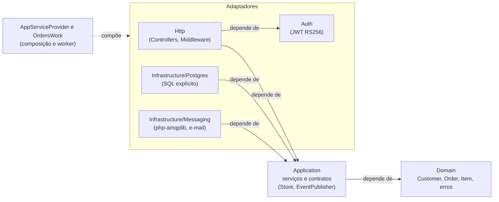
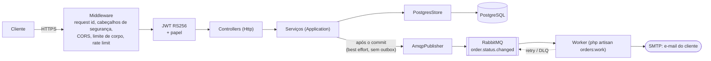

# php-order-api

API de pedidos em PHP 8.4 e Laravel 13, implementando a especificação do `fastapi-order-api` ([`DOMAIN.md`](DOMAIN.md) aponta para ela e registra as diferenças). Domínio e casos de uso não dependem do framework: o Laravel cuida de HTTP, console, configuração e contêiner; o SQL é explícito (Query Builder, sem Eloquent).

- **API**: clientes e pedidos, PostgreSQL, JWT RS256.
- **Worker** (`php artisan orders:work`): consome `order.status.changed` no RabbitMQ e envia e-mail por SMTP.

## Rodando

```sh
mkdir keys   # coloque aqui jwt_public.pem (chave pública RSA do emissor dos tokens)
docker compose up --build
```

API em `http://127.0.0.1:8080`, e-mails capturados no Mailpit em `http://127.0.0.1:8025`. Todas as portas escutam apenas em `127.0.0.1`. As migrations rodam no serviço `migrate`.

Sem Docker: `composer install`, copie `.env.example` para `.env`, `php artisan key:generate`, `php artisan migrate`, `php artisan serve`.

## Configuração

| Variável | Padrão | Observação |
|---|---|---|
| `APP_ENV` | `local` | `production` liga as validações estritas abaixo |
| `DB_URL` | | conexão PostgreSQL |
| `JWT_PUBLIC_KEY_PATH` | | obrigatória na API |
| `JWT_AUDIENCE`, `JWT_ISSUER` | | obrigatórias na API; ver ADR 0003 |
| `CORS_ORIGINS` | vazio | lista separada por vírgula; em produção não pode ser vazia nem `*` |
| `MAX_BODY_BYTES` | `1048576` | também conta o corpo lido, não só o `Content-Length` |
| `RATE_LIMIT_PER_USER` / `_WRITES` / `_PER_IP` | `120` / `30` / `600` | por minuto; `/health` é isento |
| `BROKER_URL` | vazio | sem ela a API não publica eventos; em produção precisa ser `amqps://` |
| `SMTP_HOST`, `SMTP_PORT`, `SMTP_USER`, `SMTP_PASSWORD`, `SMTP_FROM` | porta `587` | worker; em produção STARTTLS é obrigatório |

Em produção a API se recusa a iniciar com audience/issuer ausentes, CORS vazio ou com `*`, ou broker sem TLS (`App\Config\Settings`).

PHP não compartilha estado entre requisições: o limite de requisições usa o cache do Laravel. Com mais de uma instância, use um cache compartilhado (`CACHE_STORE=redis`); com uma só, `file` basta.

## Endpoints

| Método e rota | Quem pode |
|---|---|
| `GET /health` | público (verifica o banco) |
| `POST /customers`, `PUT /customers/{id}`, `DELETE /customers/{id}` | papel `admin` |
| `GET /customers/{id}`, `GET`/`POST /customers/search` | qualquer usuário autenticado |
| `POST /orders`, `GET`/`DELETE /orders/{id}`, `GET`/`POST /orders/search` | qualquer usuário autenticado |
| `POST /orders/{id}/items`, `PATCH`/`DELETE /orders/{id}/items/{item_id}` | qualquer usuário autenticado |
| `POST /orders/{id}/confirm`, `POST /orders/{id}/cancel` | qualquer usuário autenticado |

O contrato completo está em [`api/openapi.yaml`](api/openapi.yaml), mantido igual às rotas e aos códigos de erro por testes.

Busca: `page` (base 0), `size` (1 a 100, 0 ou ausente usa 20), `sort` (`-campo` para decrescente). A forma `POST` aceita `filters`: `{"campo": [{"op": "gte", "value": 2}]}` com `eq, neq, gt, gte, lt, lte, in, between, lk`. Valores são convertidos para o tipo da coluna (tipo errado é `VALIDATION-05`), `lk` escapa `%` e `_`, campo de filtro desconhecido é ignorado e campo de ordenação desconhecido é `VALIDATION-06`.

Erros: `{"message", "code", "params", "request_id"}`; o catálogo está no OpenAPI. A resposta de cliente expõe apenas `id` e `name`: documento, passaporte e e-mail são PII e nunca saem pela API nem pelos logs. Valores monetários saem como número JSON com duas casas.

## Garantias de concorrência

- Pedido e cliente têm coluna `version`; escrita com versão antiga falha com `CONFLICT-00`.
- Criar pedido toma `FOR SHARE` no cliente e excluir cliente toma `FOR UPDATE`, na mesma transação da verificação de pedidos ativos: nunca nasce pedido sob um cliente excluído (teste de integração com segunda conexão e `lock_timeout`).
- Unicidade de documento e passaporte é garantida por índices únicos parciais (`WHERE deleted_at IS NULL`); a checagem no service só dá a mensagem amigável.

## Arquitetura



A dependência aponta sempre para dentro: o domínio não conhece nada, a aplicação declara o que consome e os adaptadores implementam. O Laravel é só a casca HTTP e o contêiner; `Domain` e `Application` não conhecem o framework.

**Uma requisição e o e-mail que ela dispara**



A API e o worker são dois processos independentes, ligados só pela fila. Se o broker estiver fora do ar, a transição do pedido continua válida e a falha só é registrada ([ADR sobre a ausência de outbox](docs/adr/0002-sem-outbox-transacional.md)).

## Desenvolvimento

O projeto é escrito em TDD: o teste falha antes do código existir.

```sh
make verify              # composer audit, Pint, PHPStan (max + strict rules), testes unitários e de API
make test-integration    # precisa de PostgreSQL e RabbitMQ: docker compose up -d postgres rabbitmq
```

- `tests/Unit`: domínio, serviços (contra um store em memória transacional), JWT, busca, mensageria.
- `tests/Feature`: a aplicação real (rotas, middleware, controllers) com store em memória e tokens RS256 reais.
- `tests/Integration`: repositórios, HTTP ponta a ponta e AMQP contra PostgreSQL e RabbitMQ reais; ignorados sem `DB_URL`/`BROKER_URL`.

Decisões de arquitetura em [`docs/adr`](docs/adr).
